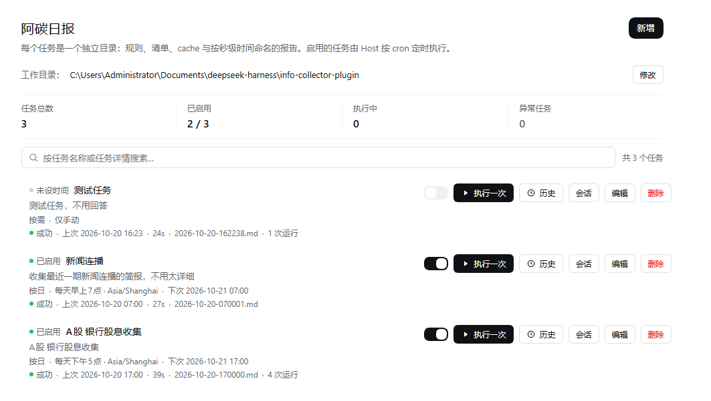
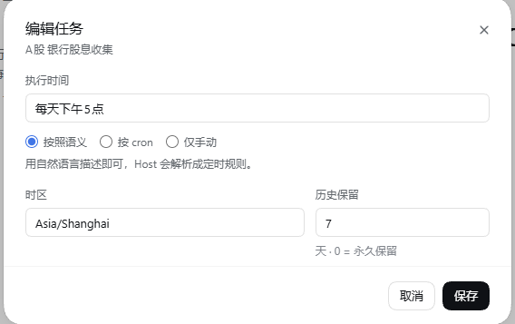
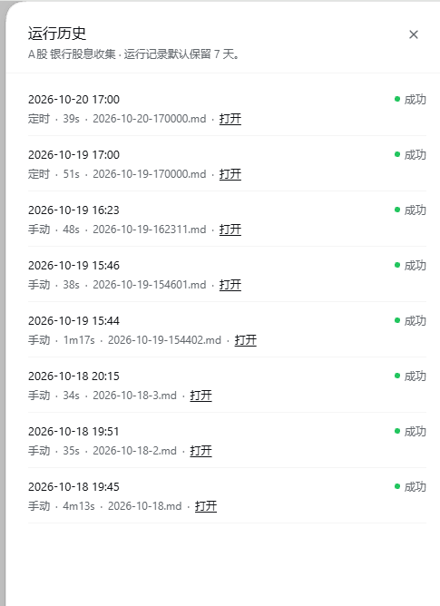
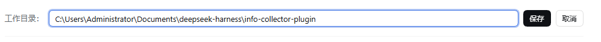

<p align="center">
  
</p>

<div align="center">

# 阿碳日报

**把选题变成按计划自动执行的日报，每期一份带时间戳的报告**

[产品文档](产品文档.md) · [MIT](LICENSE)

[](LICENSE)
[](https://www.npmjs.com/package/dsh-atan-daily)
[](https://www.npmjs.com/package/dsh-atan-daily)
[](https://github.com/artaniszhou/dsh-atan-daily)
[](#安装)

</div>

> 阿碳日报是社区维护的 DeepSeek Harness（DSH）插件，并非 DeepSeek AI 官方产品。

本文描述 **1.0.0**。目录结构、Host 接口、配置项与发布流程见[产品文档](产品文档.md)。

## 功能概览

给每个选题一个目录和一份规则，剩下的事按计划自动发生。

- **定时执行**：执行时间可以用日常说法（「每天 9 点」「每周一和周四 8 点」）、五段 cron 表达式，或者干脆只手动执行；每个任务单独设置 IANA 时区。
- **一任务一目录**：每个选题就是一个文件夹，规则写在 `meta/rule.md`，任务清单存在 `task-list.jsonl`；改规则不用改代码。
- **每期一份报告**：报告按本次开始时间命名（如 `2026-10-17-090000.md`），固定宽度便于排序，同一秒内重跑自动加 `-2`、`-3`，不覆盖旧报告。
- **独立会话**：每次执行都由 Host 新建一个普通会话，旧会话自动归档；侧栏里能点进去看完整过程。
- **运行历史**：每次执行的状态、耗时、报告、会话与错误都有记录，可按任务设置保留天数（默认 7 天，`0` = 永久）。
- **补跑与排队**：休眠或停机错过的多个时间点只补最近一次；多个任务同时到点时排队串行执行，避免并发撞限流。
- **统计与搜索**：列表顶部显示任务总数、已启用、执行中、异常任务；搜索按名称或详情实时过滤，每页 10 条。
- **跟随 DSH 主题**：颜色、圆角、阴影、动效全部来自 `--dsw-*` 语义令牌，浅色与深色模式零改动。

## 界面预览

> 截图存放于 `assets/screenshots/`，把图片放进去并保持下列文件名一致即可正常显示。

<!--
截图建议（替换下方同名文件）：
  task-list.png     任务列表：统计条、搜索、任务行与调度状态
  task-editor.png   新建 / 编辑：口语与 cron 两种时间输入、时区选择
  run-history.png   运行历史抽屉：状态、耗时、报告与会话
  settings.png      工作目录：路径修改与创建（可选）
推荐宽度 1600px，PNG 或 WebP，浅色或深色保持统一。
-->

**任务列表：统计、搜索与调度状态**



**新建 / 编辑：用日常说法或 cron 设置执行时间**



**运行历史：每次执行的状态、耗时与报告**



**工作目录：修改路径并自动注册为 DSH 工作区**



## 安装

需要已安装并能正常运行 DeepSeek Harness，版本 **0.2.1 及以上**（插件要求 `dsh >=0.2.1-0 <0.3.0`）。

### 让 Agent 帮你安装

把这段话发给能够操作本机终端的 Agent：

```text
请把 dsh-atan-daily 最新版安装到我的 DSH web profile，使用官方 npm 源，安装后重启宿主并确认侧栏「自动化任务」下方出现「阿碳日报」。
```

### 手动安装

```bash
dsh plugin --profile web add dsh-atan-daily
```

也可以打开 Web UI：「设置 → 插件 → 添加插件」，输入包名 `dsh-atan-daily` 安装。

安装或升级后重启宿主并刷新页面，侧栏「自动化任务」下方即出现「阿碳日报」。

npm 官方源较慢时可指定镜像：

```bash
dsh plugin --profile web add dsh-atan-daily --registry=https://registry.npmmirror.com/
```

从源码或本地目录试用：

```bash
git clone https://github.com/artaniszhou/dsh-atan-daily.git
cd dsh-atan-daily
npm install
npm run build
dsh plugin --profile web add .
```

以 `link:` 方式安装时：Client 改动重新构建后刷新页面即生效；Host 改动需要重启宿主。

> 仓库不包含构建产物 `lib/`，克隆后必须先执行 `npm run build`。因此本插件不支持直接用 Git 地址安装，请使用 npm 包，或构建后按上面的本地目录方式安装。

> 若你之前用本地 `link:` 装过旧包名 `@artanis/atan-daily`，请先用 `dsh plugin --profile web remove @artanis/atan-daily` 移除，避免同一个插件 id 出现两次。

## 使用说明

| 你想做什么 | 如何操作 |
| --- | --- |
| 新建选题 | 点「新建任务」，填写名称与任务详情（目标、数据来源、输出要求），再设置执行时间。 |
| 设置执行时间 | 「按说法」写日常表达，「按 cron」写五段表达式，「仅手动」则只能点「执行一次」。 |
| 临时跑一轮 | 点任务行上的「执行一次」，完成后会跳到它新建的会话。 |
| 查看报告 | 报告写在任务目录下；「历史」抽屉里每轮记录都链到对应报告。 |
| 看执行过程 | 点「会话」进入该任务的会话；已有会话会直接打开。 |
| 改工作目录 | 页面顶部点「修改」，保存时会创建目录并注册为 DSH 工作区；运行中不允许切换。 |
| 停掉某个选题 | 关闭任务行上的开关；不会删除文件和历史。 |

任务目录长这样：

```text
<工作目录>/
├── task-list.jsonl            任务元数据（唯一权威）
└── A股 银行股息收集/           任务目录 = 任务名称
    ├── meta/
    │   ├── rule.md            任务规则（缓存与脚本清单也在这里）
    │   ├── cache/   script/   稳定数据与脚本
    │   └── runs/              每次运行的 JSON 记录
    └── 2026-10-17-090000.md   历次报告，并列在任务目录下
```

## 工作方式

```text
浏览器（列表 / 新建 / 启停 / 执行一次）
        │  HTTP
        ▼
Host：cron 定时 → 到点 → 新建会话 → 送入指令 → 等待完成 → 写运行记录与报告
```

执行发生在 Host 侧，所以关掉页面不影响定时任务。每次执行固定使用 `deepseek-flash` 模型，并以完全权限、免审批方式自动运行，请先在测试选题上验证规则再交给定时任务。

- 到点判断允许晚触发：机器休眠后迟到仍算这一次；重启只补最近一次错过的执行。
- 无执行时间的任务只能手动执行；停用的任务不参与定时。
- 执行失败不自动重试，错误写入 `lastError`，下次按计划继续；单轮默认超时 1800 秒。

## 反馈与贡献

遇到问题或有建议，欢迎[提交 Issue](https://github.com/artaniszhou/dsh-atan-daily/issues)。请附上 DSH 与插件版本、复现步骤，以及相关截图或日志；涉及选题规则时可先删去敏感内容。

源码位于 `src`，使用严格 TypeScript，Host 与 Client 分开构建。改动后请执行：

```bash
npm test       # 类型检查 + 单元与组件测试
npm run build  # 构建 lib/
npm run check  # test + build + 两个 smoke，提交前跑一遍
```

界面文案同时维护 `locale/zh.json` 与 `locale/en.json`，两边键集合需一致；颜色只用 `--dsw-*` 语义令牌，不要引入独立调色板。架构细节、HTTP 接口与数据格式见[产品文档](产品文档.md)，欢迎提交改进。

## 许可证

[MIT](LICENSE) © 2026 Artanis Zhou
