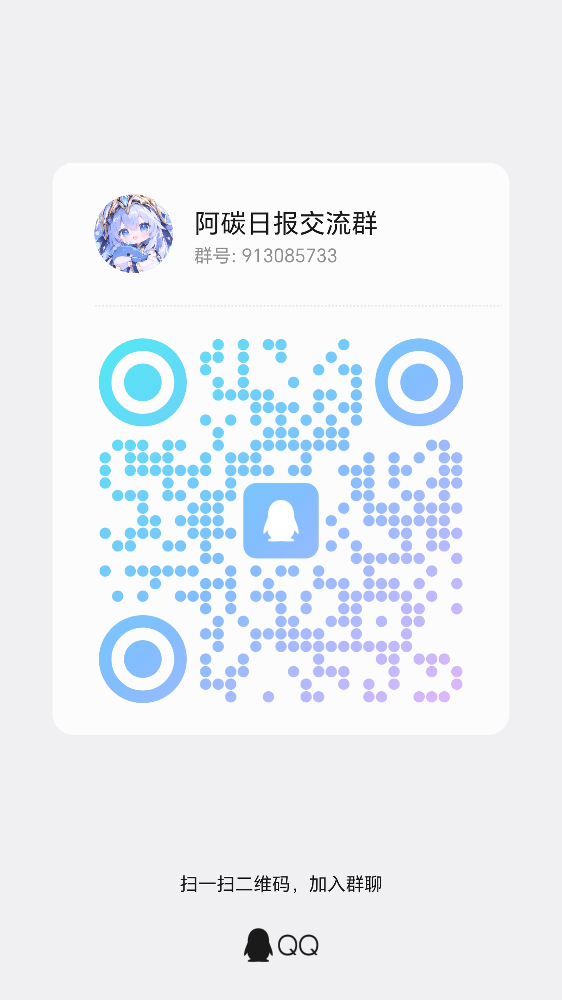

# 联系作者

阿碳日报（`dsh-atan-daily`）由社区维护，日常交流都在 QQ 群「阿碳日报交流群」里：安装、配置、任务跑不通，或者想聊聊报表效果，直接进群问就行。

> 本项目并非 DeepSeek AI 官方产品。

## 加入 QQ 群

- 群名称：阿碳日报交流群
- 群号：**913085733**
- 手机 QQ 扫上面的码，或在「加好友/加群」里搜索群号申请加入；图片看不清可以点[查看原图](./assets/qq-group.jpg)。

## 进群提问前

为了少来几个来回，提问时尽量带上：

- DSH 版本与插件版本（插件页面或 `package.json` 里能看到）；
- 复现步骤：点了什么、期望看到什么、实际发生了什么；
- 相关截图或运行日志，涉及选题规则时先把敏感内容删掉。

## 隐私与安全

- 群里不要贴 App Secret、token、账号密码或完整凭据；
- 报告安全问题时先只描述影响范围，不要贴可复现的利用代码。
